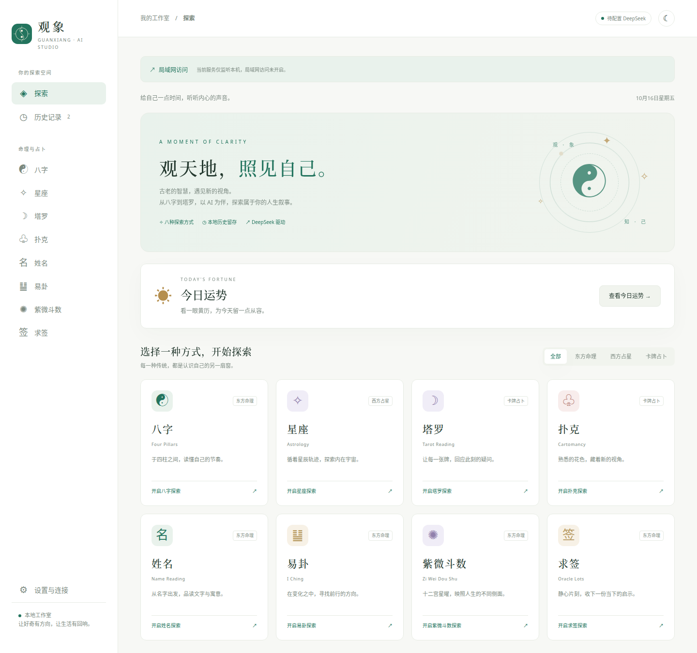
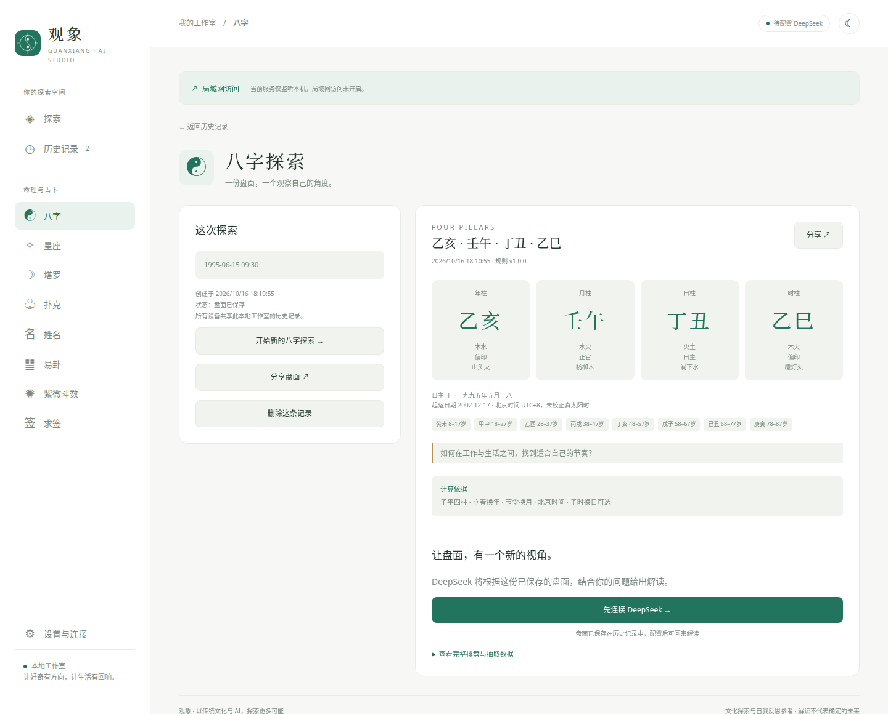
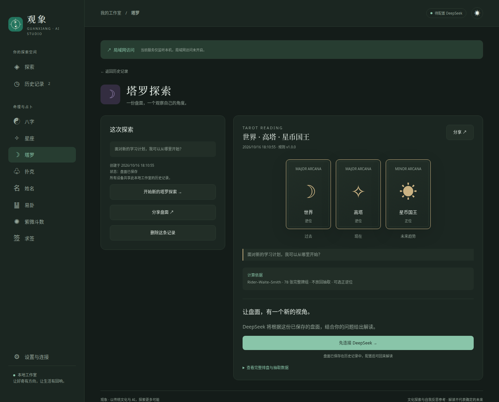

  

<strong>本地排盘 · DSH 解读 · 历史与分享</strong>

八种探索方式，共用你的 DSH Web 模型与凭据。

  <a href="#功能特征">功能特征</a> ·
  <a href="#界面预览">界面预览</a> ·
  <a href="#快速开始">快速开始</a> ·
  <a href="docs/README.md">使用文档</a>

## 功能特征

| 功能 | 体验 |
| --- | --- |
| 🧭 八种探索 | 八字、星座、塔罗、扑克、姓名、易卦、紫微斗数、求签 |
| 🤖 DSH 原生接入 | 复用宿主默认模型与 API Key，页面独立端口、直接访问 |
| 🗓️ 日常工具 | 今日黄历、姓名康熙笔画自动查询与手动核实 |
| 💾 历史与缓存 | 搜索、筛选、删除记录；已完成解读再次打开直接读缓存 |
| ↗️ 盘面分享 | 保存可离线阅读的 HTML 网页，或复制局域网记录链接 |
| 📊 用量可见 | 展示实际 token 用量与费用估算 |
| 🌓 阅读体验 | 浅色 / 深色主题，适配电脑与手机 |

## 界面预览

探索首页集中展示八种方式与今日黄历。以下截图均使用演示数据。

查看八字排盘与深色塔罗牌阵

**八字排盘** · 展示四柱、五行、十神与大运，自动保存记录并支持分享。

**深色塔罗** · 三张时间牌阵，展示正逆位与过去、现在、未来趋势。

## 快速开始

先准备已安装的 **DSH**，并在 DSH Web 中配置 API Key 与默认模型。

启动时要求 **DSH ≥ 0.2.0-rc.2**；缺失或过低时自动准备目标版本并重新注册 Web 插件，符合要求的新版直接复用。

| 环境 | 启动方式 |
| --- | --- |
| Linux / macOS | `sh start.sh` |
| Windows | 双击 `start.bat` |
| 已有 Node.js ≥22.13 | `npm start` |

页面独立监听 **`0.0.0.0:3100`**，本机地址为 <http://127.0.0.1:3100/>。端口占用时，直接绑定系统分配的空闲端口；启动日志和自动打开的页面使用实际端口。可通过 `FORTUNE_PORT` 或插件的 `port` 配置指定首选端口。

同一局域网设备使用 `http://主机局域网IP:实际端口/` 直接访问，无须登录或 token。继续复用 DSH 的模型与凭据；DSH 管理页面保留原有认证，仍可只监听本机。旧的 DSH 子路径保留兼容，日常启动自动打开独立端口。

选择方式 → 填写信息 → 生成盘面 → 点击解读。**盘面计算不调用 AI**，解读使用 DSH 的生成服务。

## 文档

[安装与启动](docs/getting-started.md) · [使用指南](docs/user-guide.md) · [完整文档](docs/README.md)

[规则与 Skill](docs/rules.md) · [数据与分享](docs/data.md) · [故障排查](docs/troubleshooting.md)

用于文化探索与自我反思。采用 <a href="LICENSE">MIT License</a>，第三方依赖遵循各自许可证。
